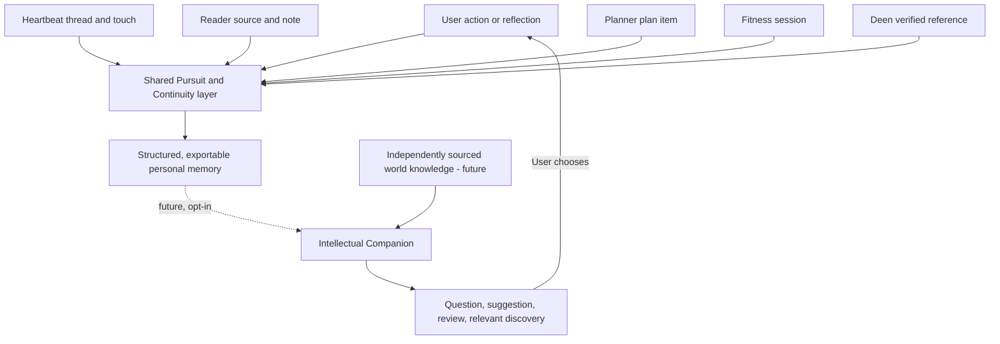
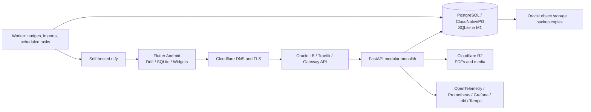
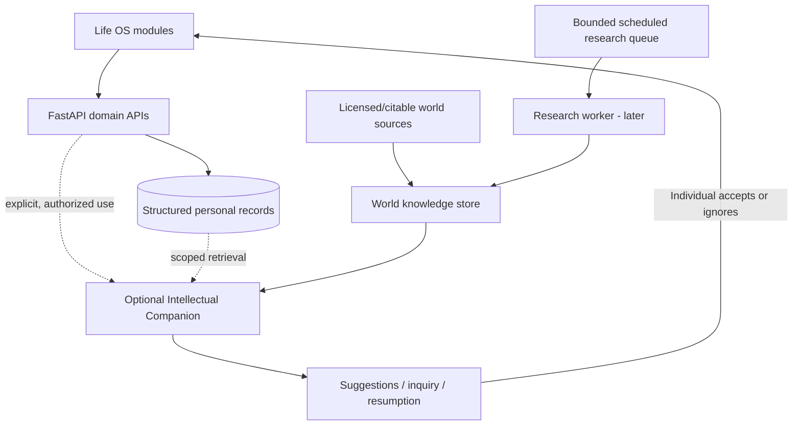
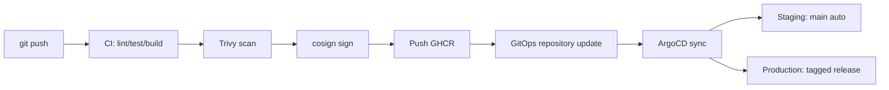

# As-Sa'ee | السعي

## The Striving — A Personal Life OS, Built First; An Intellectual Companion, Developed Later

**Document type:** Unified product vision, living master plan, and staged architecture  
**Version:** 1.1 — consolidated proposal  
**Updated:** 10 November 2026  
**Project identifier:** `assaee`  
**Website planned:** `as-saee.com`  
**Android application ID:** `com.assaee.app`  
**Current baseline:** M0 — early planning/setup; nothing deployed as of the 9 November 2026 planning document  
**Current priority:** Deliver a useful, dependable Life OS and a demonstrable DevOps/cloud platform. **The Intellectual Companion is a committed long-term goal, built only after the Life OS works and the resources exist; it is not part of v1.**

> **السعي — The Striving.** The individual must strive; the system should recognize, preserve, and support that striving, not replace it.

> **Unifying idea:** As-Sa'ee is the environment in which intentions become sustained action and understanding. The future Intellectual Companion is the intelligence that can deepen understanding, investigate truth, and guide meaningful exploration across that environment.

---

## Document map

1. [Purpose, origins, and product decisions](#1-purpose-origins-and-product-decisions)
2. [Vision and the problem to solve](#2-vision-and-the-problem-to-solve)
3. [Principles and non-negotiable boundaries](#3-principles-and-non-negotiable-boundaries)
4. [Build strategy: Life OS first, intelligence last](#4-build-strategy-life-os-first-intelligence-last)
5. [Product experience and daily use](#5-product-experience-and-daily-use)
6. [Heartbeat: the first real feature](#6-heartbeat-the-first-real-feature)
7. [Life OS modules](#7-life-os-modules)
8. [Shared pursuits, continuity, and memory foundation](#8-shared-pursuits-continuity-and-memory-foundation)
9. [Future Intellectual Companion: identity and behavior](#9-future-intellectual-companion-identity-and-behavior)
10. [Future truth, knowledge, and independent inquiry](#10-future-truth-knowledge-and-independent-inquiry)
11. [System architecture and infrastructure](#11-system-architecture-and-infrastructure)
12. [Data, offline sync, export, and privacy](#12-data-offline-sync-export-and-privacy)
13. [Delivery, operations, and security](#13-delivery-operations-and-security)
14. [Repositories and ownership](#14-repositories-and-ownership)
15. [Milestone roadmap](#15-milestone-roadmap)
16. [Feature boundaries and deferred work](#16-feature-boundaries-and-deferred-work)
17. [Testing and definitions of success](#17-testing-and-definitions-of-success)
18. [Risks, trade-offs, and open decisions](#18-risks-trade-offs-and-open-decisions)
19. [Next actions](#19-next-actions)
20. [Provenance and change-management notes](#20-provenance-and-change-management-notes)

---

# 1. Purpose, origins, and product decisions

As-Sa'ee is **one project**, with two horizons and two mutually reinforcing purposes.

### Purpose A — a daily-use Life OS

An offline-capable personal system for reading, planning, fitness, and deen, extendable to learning, work, research, language acquisition, writing, and other areas of life. Its first job is to ensure that important things do not quietly disappear when circumstances change. It is intended to be used in real life, beginning with a small heartbeat feature rather than a large unfinished platform.

### Purpose B — a public, production-grade engineering portfolio

The platform itself is a product of the work: Terraform, Ansible, Kubernetes/k3s, GitOps, CI/CD, observability, backups, security, disaster recovery, and a temporary AWS replica. The project supports a DevOps/cloud-architect career target in Spain. **Career and a functioning Life OS take priority over ambitious AI features.**

### Long-term horizon — the Intellectual Companion

As-Sa'ee may eventually gain a knowledge-rich, Quran-anchored, source-transparent Intellectual Companion. It will understand the individual through their interactions and deliberate reflection; maintain continuity of aspirations and inquiries; broaden understanding through relevant discoveries; and, when resources allow, conduct bounded independent research. It should help the individual think and act independently rather than produce dependence on itself.

**The project is not being split into a scheduler plus a separate AI app.** The future companion belongs within As-Sa'ee and builds on its existing modules and trustworthy data. The Life OS must remain fully usable when AI is absent, disabled, unaffordable, offline, or malfunctioning.

### Status discipline

This is a **consolidated specification and proposed evolution**, not a claim that the new features are implemented. The source planning PDF describes M0 as in progress and nothing deployed. Proposed future models, APIs, and behaviors in this document are labeled as such. Existing source files and ADR 0001 remain the authority for what the code currently does; reconcile them before migrations.

---

# 2. Vision and the problem to solve

## 2.1 The original problem: things go quiet

A person begins a book, project, research question, workout routine, practice, or learning path. Attention moves elsewhere. The first activity vanishes from awareness for days or weeks, not necessarily because it ceased to matter but because the environment, urgency, competing responsibilities, or temporary lack of resources changed.

The problem is not simply that information is scattered. It is **out of sight, out of mind**. The original As-Sa'ee heartbeat is designed to pull threads back without shame or a flood of notifications.

## 2.2 The deeper problem: the original intention can also disappear

A reminder may restore awareness of a book, but not of:

- Why it originally mattered.
- Which question the person was pursuing.
- What was understood, attempted, or accomplished.
- Which source, passage, experiment, or argument was last considered.
- What remains unresolved.
- The easiest meaningful way to resume under current circumstances.

As-Sa'ee should grow from **remembering activity** to **preserving continuity of intention and understanding**. This can begin with ordinary structured data and an optional one-line checkpoint; AI is not required.

## 2.3 An unrestricted human horizon

A pursuit is not restricted to tasks, skills, health, productivity, career, or even knowledge. An individual may seek an experience, develop a capability, create something, investigate a question, seek truth, or reflect on any aspect of existence: living or nonliving things, matter, energy, body, soul, humans, animals, planets, stars, religion, history, philosophy, science, and questions not yet imagined.

The system must therefore avoid reducing every pursuit to a deadline, numeric score, task, habit, or subject category. It should support open-ended inquiry without demanding artificial completion.

## 2.4 What success means

Success means that meaningful intentions survive interruption; the individual can return with minimal friction; the tools encourage actual learning, practice, worship, and good living; the platform is reliable and demonstrably engineered; and, much later, added intelligence strengthens independence and understanding rather than engagement with the app itself.

**The app succeeds when the person can close it and go live.**

---

# 3. Principles and non-negotiable boundaries

The source plan already sets strong rules. Keep them as product constraints rather than marketing phrases.

| Principle | Product behavior |
|---|---|
| **Prayer- and sun-anchored day** | Organize planning around prayer windows rather than only clock-hour schedules; local conditions and configuration matter. |
| **Minimum meaningful form** | One ayah, one page, a very small workout, or another reduced version can count fully. |
| **No failed days; only returns** | Track consistency over windows, allow repair, never reset all history or shame the individual for interruptions. |
| **If–then implementation intentions** | Support user-written plans such as “after X, I do Y,” including prayer and routine anchors. |
| **Niyyah and muhasaba** | Short morning intentions and a brief, constructive evening review; reflection ends with a possible resolve, not endless rumination. |
| **No gamification or guilt** | No points, public leaderboards, manipulative feeds, streak-loss prompts, spirituality scores, or engagement spam. |
| **Mastery by demonstration** | Capability levels represent what was actually demonstrated, ideally witnessed by a qualified person where relevant, not hours accumulated. |
| **Retrieval over passive rereading** | Help the individual recall highlights, vocabulary, ayat, and notes through questions and spaced review. |
| **Health as regimen** | Balance sleep, movement, food, light/air, emotions, and rest rather than optimizing a single metric. |
| **Finish naturally** | The system should make it easy to exit; success is not time spent in-app. |
| **User-authored direction** | The individual owns their plans, pursuit choices, interpretations, and final decisions. |
| **Gradual development — tadrij** | Add difficulty, responsibility, and functionality progressively. |
| **Protect attention** | One primary focus at a time, few opt-in notifications, no infinite discovery stream. |
| **Companionship without social pressure** | Optional private study/teacher/partner connections, never public comparison. |

The original research base associates these ideas with sources including Bukhari 6464, Lally (2010), implementation-intention research, and classical Islamic scholarship. It describes forgiving 40-day consistency windows and a 90-day exercise-habit arc; the reported implementation-intention effect estimate is `d = 0.65` in that research summary. Preserve citations and evidence-strength labels from the underlying research files; **do not treat this master plan as independent verification of every study, numerical effect estimate, hadith reference, or religious interpretation.**

### Additional principles from the Intellectual Companion discussion

1. **Preservation of intent.** Protect the original purpose even when circumstances change.
2. **Anchored exploration.** New knowledge must meaningfully deepen the current pursuit; interesting irrelevance is not a justification to interrupt.
3. **Truth over agreement.** The system should not flatter, confirm assumptions mechanically, or hide uncertainty.
4. **Independent individual.** A companion should increase the person's ability to reason and act without it.
5. **No forced profiling.** Personal understanding emerges only from the user's actual interactions and deliberate reflection, not surveillance or invented psychological labels.
6. **Distinguish evidence and interpretation.** Source texts, translations, scholarly commentary, empirical findings, and hypotheses must remain separate.
7. **Quran-anchored worldview.** In the chosen truth framework, the Quran is the ultimate authority; apparent conflicts call for careful investigation of interpretation and evidence, never invented reconciliation.
8. **The companion remains corrigible.** The individual may inspect, correct, reject, export, or delete its personal inferences.
9. **No false autonomy.** Independent research requires real scheduled computation, retrieval, controls, and resources. Do not claim a dormant model keeps thinking.

### Prohibited product patterns

No autoplay or algorithmic addiction feeds; coins, XP, and badges for worship; public comparison; paid streak freezes; loss-framed notifications; obligatory journaling; “21 days forms a habit” promises; AI-generated fatwas; fabricated Quranic/Hadith text; hidden automatic task creation; unquestionable personal profiling; unsolicited invasive tracking; or autonomous agents acting beyond user-granted authority.

---

# 4. Build strategy: Life OS first, intelligence last

## 4.1 The binding priority order

1. **A working heartbeat** that prevents forgotten threads and exercises an end-to-end delivery pipeline.
2. **Reliable infrastructure** with appropriate security, delivery, observability, backup, and restore behavior.
3. **A useful offline-capable Life OS:** Reader, Planner, Fitness, and Deen, in the existing milestone order.
4. **A clean continuity and source-data foundation** embedded into ordinary module work, but never permitted to block the core product.
5. **Intelligent retrieval and companionship only when affordable and genuinely useful.**
6. **Independent research and advanced personalization last**, only when there are adequate compute, source access, evaluation, security, time, and operational resources.

### Reality constraints

- Single user initially, but use real authentication and owner-scoped records.
- EU-resident data is a stated project objective; confirm processing locations and terms for any later external AI provider.
- Oracle Always Free ARM is the planned primary environment. Availability and memory are limited; design to survive instance loss.
- **No paid AI APIs in v1.** The heartbeat's “smart” behavior is statistics and explicit rules.
- Do not add a graph database, autonomous agent fleet, heavy local LLM, or microservice split because the future vision sounds ambitious.
- The existing project roadmap is intentionally DevOps-heavy; do not let foundational design postpone the first usable app.
- Later dates in the original plan are intentions, not commitments. Companion work is gated by capabilities and resources, not a promised calendar date.

## 4.2 Phase separation

| Horizon | Core deliverable | AI required? | Life OS usable without AI? |
|---|---|---|---|
| **Now: M0–M1** | Heartbeat + deployment walking skeleton | No | Yes: reminders that respect actual rhythms |
| **Foundation: M2–M4** | Secure, observable, recoverable infrastructure and database | No | Yes: reliable personal data |
| **Life OS: M5–M8** | Reader, Planner, Fitness, Deen (AWS replica runs as side track S1) | No | Yes: daily-use integrated application |
| **Continuity enhancements** | Optional pursuit links, source references, checkpoints, resumption | No | Yes: preserved intentions and progress |
| **Companion foundation — later** | Source-grounded retrieval, personal context, reflection, explanations | Yes | The Life OS stays fully usable without it |
| **Independent inquiry — much later** | Scheduled research, competing claims, discovery proposals | Yes + research infrastructure | The Life OS stays fully usable without it |
| **Advanced models — conditional** | Fine-tuning or self-hosted inference only if justified | Yes + additional resources | Not a prerequisite |

**Decision:** Model some future continuity needs early; **do not build the Intellectual Companion early**.

---

# 5. Product experience and daily use

The experience begins with direct, practical action rather than a conversational prompt.

## 5.1 The future three-surface concept

- **Today:** prayer-window plan, immediate tasks, small habits, workouts, reading goals, prayer/ritual information, and actual constraints.
- **Continue:** quiet threads, recent work, optional checkpoints, and the next reasonable way back into a pursuit. This surface can exist without AI.
- **Discover:** eventually, source-backed material strongly connected to ongoing pursuits. Initially this can be saved links and manually filed research; the AI-assisted discovery shelf is later and pull-first.

These are **conceptual information surfaces**, not a mandate to build three top-level tabs in v1.

## 5.2 Engagement modes

| Mode | Need | Simple Life OS behavior | Future companion behavior |
|---|---|---|---|
| **Deep** | Time and resources available | Open document, project, plan, or session and continue | Investigate, critique, teach, connect sources, pose a deeper challenge |
| **Limited** | Five minutes, commuting, no laptop | Read one page, record an idea, review a question, complete a minimum form | Offer a genuinely small relevant action or thought experiment |
| **Re-entry** | Returning after days or weeks | Show last known touch, saved checkpoint, note, and next step | Reconstruct context **from actual records**, disclose missing context |
| **Reflection** | Reconsidering intent or progress | Brief niyyah, muhasaba, optional checkpoint | Ask a few timely, meaningful questions instead of a personality questionnaire |
| **Offline** | No network or limited access | Local reading, logging, notes, and pending sync | Cached source/context only where actually available; never pretend cloud research ran |

The environment changes; the core pursuit does not disappear. Adapt to constraints explicitly communicated by the user. **A snooze is not proof that interest was lost.**

## 5.3 An illustrative flow

A person studies the nature of time through a book, saves a passage and a question, and records “compare how relativity defines measured time with philosophical notions of time.” Later, traveling without a laptop, they can review the question or continue reading offline. After an interruption, As-Sa'ee offers the actual saved note. Much later, the companion might propose a *documented* connection to another scientific or philosophical inquiry; it would not overwrite the original question or force a task onto the planner.

## 5.4 Success is not engagement volume

Prefer evidence of sustained meaningful activity, successful returns, usable continuation, real-world learning/practice, and low friction. Do not optimize chat length, time in the app, notification clicks, or manufactured emotional attachment.

---

# 6. Heartbeat: the first real feature

**Original planned placement:** `assaee-api`, milestone M1.  
**Original implementation intent:** pure logic in `app/heartbeat.py`, testable independently of a database or wall clock; SQLite persistence in M1; PostgreSQL from M3.

A **thread** is anything worth keeping alive: a book, project, training routine, research area, or other activity. Creation requires only a **name**.

## 6.1 Original rhythm rules — preserve behavior

| Rule | Specification in the source plan |
|---|---|
| Initial book rhythm | 24 hours |
| Initial project rhythm | 24 hours |
| Initial gym rhythm | 72 hours |
| Initial research rhythm | 168 hours |
| Initial other rhythm | 72 hours |
| Learned rhythm | Median gap between distinct days with touches, after sufficient observations; multiple touches in one day count once for the rhythm |
| Quietness | Current gap reaches 1.5× usual gap |
| Allowed days | Per-thread active weekdays |
| Quiet hours | 22:00–07:00 local by default |
| Snooze | Later today, tomorrow, or pause until a date, including travel/Ramadan/exams |
| Nudge adaptation | Snoozes/ignored nudges back off per thread; threshold grows but is capped at 3×; a touch resets the adjustment |
| Nudge budget | `GET /nudges` returns at most 3 individual nudges by default, ordered by overdue level, plus one grouped summary of remaining items |
| Copy | Plain and neutral, e.g. “Book: last touched 3 days ago” |
| Delivery plan | Self-hosted `ntfy` phone push with one-action Done; highest-priority nudges may behave as alarms; Flutter local notifications/widgets later |

The algorithm needs precise rules for sparse histories, timezone changes, boundary conditions, paused threads, and touches on consecutive versus same dates. Preserve existing tested behavior rather than rewriting it in pursuit of AI-readiness.

**Thread categories:** heartbeat, capture inbox (including links/research ideas shared from reels or elsewhere on the phone; the inbox itself can resurface when crowded), and later fixed-time reminders such as prayer-related items. The original plan reserves potential automatic touches from GitHub commits, opening a VS Code project, and workout logs for later; they are not part of the first version and would require explicit authorization. An Android system/root application was deliberately rejected in the source plan in favor of ordinary app notifications and exact-alarm permissions where appropriate.

## 6.2 Current/planned API surface from the original document

| Method | Route | Purpose |
|---|---|---|
| `GET` | `/health` | Liveness |
| `POST`, `GET` | `/threads` | Create/list |
| `PATCH`, `DELETE` | `/threads/{id}` | Rename, configure rhythm/active days, or soft-delete |
| `POST` | `/threads/{id}/touch` | Record touch |
| `POST` | `/threads/{id}/snooze` | Snooze |
| `GET` | `/nudges` | Prioritized capped nudges and grouped remainder |

The source document calls this the current API design. Verify live schema/routes and actual tests before editing.

## 6.3 Small enhancements that do not change the product contract

- Preserve **one-tap touch** and **name-only thread creation**.
- Make touch ingestion replay-safe where practical (stable client `event_id` or idempotency key, with server-side uniqueness).
- Keep touch distinct from document-open, notification-display, and assumed “progress.”
- Allow an **optional** note/checkpoint in a later milestone: “Where did I leave off?” Never require it to finish a session.
- Offer source-linked resumption later; when there is no checkpoint, state the known last activity without inventing an explanation.
- Learn timing from touches and explicit snooze responses, **not** personal motives or character judgments.

## 6.4 Authentication boundary for M1

Keycloak arrives in M4. Until then, personal endpoints are reachable **only over Tailscale** (moved to M1, ADR 0002); only the health check is public. **Never make unauthenticated personal `/threads`, `/nudges`, `/touch` or notes publicly accessible.**

---

# 7. Life OS modules

The planned module order remains Reader (M5), Planner (M6), Fitness (M7), Deen (M8), with the AWS replica run separately as the time-boxed side track S1. Each module gets its own research/design round before implementation. The descriptions below preserve the **existing plan**, followed by **additive continuity integration**; these additions are proposals and can be postponed.

## 7.1 Reader — M5

**Purpose:** A reading and thinking environment that turns source material into personal understanding and reusable knowledge, growing from the existing React PDF reader into Flutter.

### Original scope

- PDFs stored in Cloudflare R2, backed up to Oracle object storage, synced and usable offline.
- Reading progress, bookmarks, highlights, and notes.
- A commonplace book: the individual's own headings organize saved passages; material can resurface during writing and content creation.
- **Mutala'a mode:** preview the questions before reading, recall afterward.
- **Sharh layer:** the individual's commentary threaded beneath a passage.
- **Lectio/slow mode:** pause on a passage and ask what stayed with the reader.
- Spaced questioning and self-testing of highlights.
- Reading goals feed into the Planner; no page-count leaderboards.
- Existing reader roadmap/widget fixes, full data export endpoint, and EPUB later.

### Continuity integration — additive

- A book or reading session may optionally link to one or several pursuits.
- Save stable source locations: document ID, edition where relevant, page or passage anchor, text locator, and highlight/note IDs.
- Record optional user-authored **open questions** and **next reading points** alongside notes.
- A “Continue” action restores the last genuine location and relevant checkpoint without pretending that a highlighted passage was understood.
- Do not send private document content into AI services by default; later retrieval requires permission, source rights, and appropriate provenance.
- Maintain distinction between original source quotation and the user's own commentary.

### Acceptance examples

A person can read offline, highlight a passage, leave a one-line question, return after two weeks, and reopen the exact passage and note. This should work without AI or internet access once material is cached.

## 7.2 Planner — M6 (the hub)

**Purpose:** Bring tasks, habits, reading goals, workouts, rituals, and existing heartbeat threads into one coherent daily flow. A single cross-module `plan_item` feed is the original aggregation concept.

### Original scope

**Day structure**

- Prayer-window-oriented Today view: Fajr → Sunrise; Sunrise → Dhuhr; Dhuhr → Asr; Asr → Maghrib; Maghrib → Isha; After Isha; and Anytime.
- Configurable day rollover for late-summer Isha (including Madrid conditions).
- Per-window capacity hint; do not overfill a window just because it looks empty.

**Tasks and repetition**

- Quick-add task with do-date, optional deadline, optional before/after prayer anchor with ± minute offset, or fixed-time scheduling.
- One level of subtasks.
- RRULE-based recurrence: daily, chosen weekly days, monthly, every N units; fixed occurrence versus after-completion patterns.
- Inbox, Upcoming, Overdue, seven-day view, and one-action placement of an overdue item into Today.

**Habits**

- Yes/no or count-based habits and N-per-week targets.
- Check-in from Today and widget.
- Window-based strength/consistency view, forgiving streak behavior, a “don't miss twice” reminder, and a reduced starter version after repeated misses.
- No shame-based resets or inflated “productivity” scores.

**Rituals and spiritual time structure**

- Fajr **musharata**: one to three intentions.
- After-Isha **muhasaba** in around two minutes: briefly reflect on the day, decide what to do with unfinished items, choose a next intention.
- Workday, Jumu'ah, and rest-day templates informed by the source research on al-Ghazali's awrad.
- Fresh-start opportunities on Jumu'ah, a new Hijri month, and Ramadan.
- Prayer status logging: on time, late, qada, missed; neutral presentation and no moral scoring.

**Reminders and widget**

- Inexact by default; exact alarms optional for prayer-anchored needs.
- Rolling 48-hour scheduling and home widget for the current prayer window.

### Planned exclusions in Planner v1

No drag/drop time-block calendar, Google Calendar two-way sync, stats dashboards/heatmaps, gamification, Pomodoro, Eisenhower matrix, iOS, shared lists, attachments, or location reminders. Natural-language dates and estimate-vs-actual fields are v1.1 candidates; seasonal modes are later. Keep reserved schema fields where specified in the original research rather than implementing unused screens prematurely.

### Continuity integration — additive

- A `plan_item` may **optionally** refer to a pursuit. This link does not make the pursuit itself due or complete.
- Show a compact Resume action on applicable items (last checkpoint, source link, next step).
- Small actions can be selected from the user's own minimum form rather than fabricated by an engagement algorithm.
- A task's completion does not imply the entire pursuit was achieved. A plan item's postponement does not imply loss of aspiration.
- Future AI **may suggest** a task but must not create/schedule it without explicit user approval.

## 7.3 Fitness — M7

**Purpose:** A practical physical-development module framed as an Ibn Sina-inspired regimen, without reducing health to constant optimization.

### Original scope

- Six regimen dimensions: sleep, movement, food, light/air, emotions, rest.
- Exercise library seeded from `free-exercise-db` as identified by the research plan, plus custom exercises; verify licensing/version for shipped assets.
- Routines and templates; fast live logging with prefilled sets and Previous column.
- One-tap completion of sets; warm-up, working, drop, and failure set types; optional reps in reserve (RIR).
- Crash-safe live session.
- Rest timer with background notification.
- Finish summary: volume, duration, and personal records.
- Best weight, reps at weight, Epley estimated 1RM, history, and estimated-1RM chart.
- Progressions, holds, weighted sets, team-sport activities, mobility, and optional traditional training packs.
- Body-weight log with seven-day moving average; kg/lb setting; CSV export.
- Health Connect **read** of steps and sleep sessions on app open; initial last 30 days; idempotent upsert.
- Planner integration: scheduled routine automatically resolves when its session finishes; a minimum form counts fully.

### Planned exclusions in Fitness v1

No nutrition tracking, self-progressing programs, AI-created workouts, social feed, watch application, workout videos, iOS HealthKit, background Health Connect sync, heart rate/HRV/calorie tracking, or writing sessions to Health Connect. Supersets, plate calculator, and warmup generator are later candidates.

### Continuity integration — additive

- Training pursuits can be linked to actual workouts, notes, learning materials, and experiments.
- Recorded workout events show **what was practiced**, not the person's character, motivation, or overall mastery.
- The system can eventually connect biomechanical study to training practice, but only as an optional, source-backed inquiry.
- Health and body data stay especially privacy-sensitive. They are **not** automatically made available to future model prompts or autonomous research.

## 7.4 Deen — M8

**Purpose:** Practical worship and study tools built around attributable sources, thoughtful routines, and an intellectually honest treatment of Islamic scholarship. The later companion's Quran-anchored inquiry builds on this verified source infrastructure; it does not replace qualified teachers.

### Original planned scope

| Area | Planned implementation |
|---|---|
| Prayer times and qibla | On-device `adhan_dart`; source plan cites Sahih Muslim 612 for prayer windows; Standard Asr (shadow 1×) initially; Muslim World League angles by default; “match my mosque” offsets and a Morocco option; proposed setting “no madhab, show the evidence.” |
| Quran | Tanzil Uthmani Arabic verbatim; Saheeh International English and Isa Garcia Spanish under applicable QuranEnc terms/import constraints; translations must carry source identity. |
| Recitation | Per-ayah audio via EveryAyah, including Alafasy and Husary muallim for hifz; stream and cache locally within licensing rules. |
| Tafsir (v1.5) | Ibn Kathir and al-Sa'di through the planned `spa5k` tafsir API; verify provenance, editions, availability, and rights before use. |
| Hifz | Mushaf-page tracking; FSRS spaced review; sabaq/sabqi/manzil; recite-then-reveal; lawh mode; optional memory-palace support for surah order and mutashabihat. |
| Hifz assessment | Ijazah-style capability levels signed off by teacher or partner where appropriate; app logs are not religious certification. |
| Adhkar | Curated items attributable to specific Hadith, linked to natural times (morning/evening/after salah). |
| Hadith (v2) | Planned `fawazahmed0` Hadith API import with Arabic, English, and grades attributed to named graders; request sunnah.com API access ahead of time. |
| Wird and longer arcs | Wird builder with minimum form; planned 40-day chilla arcs. |
| Optional online Quran extras | Quran Foundation API through a FastAPI proxy with a seven-day cache if access and licensing permit. |

### Religious integrity rules — mandatory

1. **Never generate Quran or Hadith wording** from the language model. Direct citations must be retrieved from a verified text store and matched exactly.
2. Quote only permitted/attributed text; keep translations tied to their translators and editions.
3. Keep scholarly commentary and tafsir distinct from the source Quranic verse.
4. Attribute Hadith grading to the grader; do not present a grade without source/context.
5. **No fatwas.** Questions requiring rulings, specialist religious judgment, or detailed hifz oversight belong with qualified scholars and teachers.
6. Public repositories should commit importers/checksums rather than copyrighted source texts where redistribution is not licensed.
7. No worship scores, moral rankings, or AI judgment of a person's sincerity (`ikhlas`).
8. Preserve interpretive disagreement where real and avoid implying that “show the evidence” abolishes scholarly methodology or disagreement.

### Continuity integration — additive

The individual may save questions arising from Quran reading, tafsir, theology, philosophy, or lived experience. Relevant verses, translations, interpretations, and secondary sources may be **linked** to an inquiry, not collapsed into an AI-generated statement of religious fact. Worship logs and private spiritual reflection remain separate from general-purpose research by default.

## 7.5 Later functional extensions

| Area | Original timing/intention | Position in the merged plan |
|---|---|---|
| Hadith search | After M8 | Build on verified, attributed Hadith store; search first, AI optional later. |
| Spanish | Later; initial habits in Planner | Retrieval-first spaced vocabulary, rihla-style real-world missions in Spain, and a later conversation partner. |
| Content creation | Original plan: 2027–2028 | Commonplace book → collect, arrange, compose; apprenticeship ladder of imitate, adapt, create. Dates are provisional. |
| DevOps learning ladder | Cross-cutting | Mubtadi, sani', mu'allim levels earned by observable outcomes (deployed, debugged, restored), not study hours. |
| RAG over personal data | Original rough target: ~2027 | **Move behind Life OS readiness/resource gate**; must not become a requirement for M1–M8. |
| Fine-tuned model | Original rough target: ~2028 | **Fine-tuning is one possible method for the companion, not a milestone**; evaluate against structured retrieval, privacy, compute, and real user benefit. |
| iPhone | Later | Cloud macOS CI and WidgetKit split considered; Android remains first. |

---

# 8. Shared pursuits, continuity, and memory foundation

This is the principal **integration decision** between the Life OS and the future companion. It is a modest shared domain, not an AI subsystem. It should be designed now, introduced when the data layer and priorities permit, and used by the ordinary modules before a companion exists.

## 8.1 Four concepts that must remain separate

| Concept | Meaning | Example | Needs schedule? |
|---|---|---|---|
| **Pursuit** | An aspiration, inquiry, practice, capability, experience, project, or direction of growth | “Understand consciousness and personal identity” | **No** |
| **Thread** | A heartbeat for something the person wishes to return to | “Read chapter four” | Adaptive rhythm |
| **Plan item** | A discrete action, obligation, routine, or scheduled activity | “Review notes after Asr” | Optional/depends on item |
| **Checkpoint** | Verifiable context for resuming after an interruption | “Compare source B's account of identity with source A” | **No** |

An inquiry must be permitted to remain open forever. A pursuit can be paused or archived but should never be labeled a failed day. A person may link multiple threads, books, workouts, reflections, or tasks to one pursuit, or leave those items unlinked. Do not impose an automatic link just because two titles sound similar.

## 8.2 Proposed minimal schema, **not currently implemented**

Names are illustrative and must be reconciled against the actual FastAPI models, SQLite schema, and ADR 0001.

### `core.pursuits`

- `id` — UUID/UUIDv7 where practical.
- `owner_id` — authenticated owner; server-enforced.
- `title` — only field required from the user to create.
- `kind` — extensible categories (`open_inquiry`, `project`, `practice`, `capability`, `experience`, etc.).
- `intent` — optional, user-authored “why.”
- `state` — `active`, `paused`, `archived`; no “failed.”
- Timestamps, revision, and deletion/archive metadata.

### `core.pursuit_links`

- `id`, `owner_id`, `pursuit_id`.
- `target_type`, `target_id` — target may be a thread, plan item, document, note, workout, Deen study record, or another pursuit.
- `relation_type` — `supports`, `explores`, `practice_for`, `related_to`, etc.
- Timestamps and soft-delete metadata; enforce ownership and target authorization at the service boundary.

### `core.engagement_events`

- Stable client-generated event ID for offline replay safety; `owner_id`.
- `event_type`, `subject_type`, `subject_id`.
- `occurred_at` (client-observed) and `received_at` (server-observed), plus provenance/origin and versioned minimal payload.
- Append-only historical event semantics, balanced with legitimate deletion requirements.
- Examples: `thread_touched`, `reading_session_completed`, `note_created`, `plan_item_completed`, `workout_session_completed`, `reflection_recorded`.

**Important:** An event proves an action was recorded; it does not prove depth of knowledge, quality of effort, intention, competence, or sincerity. Some achievements can be separately supported by teacher sign-off, tests, or demonstrations.

### `core.checkpoints`

- `id`, `owner_id`, optional `pursuit_id`, optional `thread_id` (at least one related subject required).
- `summary`, `open_question`, and `next_step`, all optional and human-editable.
- `source_kind` — `user_written`, `ai_draft`, or `user_confirmed_ai` (the AI-specific types are used only much later).
- Creation time, revision or supersession link, and optional document/note references.

A checkpoint can be just one line. When there is no checkpoint, As-Sa'ee shows known activity and says detailed context was not saved. **Never fabricate a reconstructed memory.**

## 8.3 Future personal-memory categories

These are **design boundaries now, intelligence features later**:

1. **Interaction facts** — actions, authored reflections, messages, notes, choices, and explicitly confirmed preferences, with source references.
2. **Tentative personal inferences** — hypotheses about learning style, obstacles, or preferences, labeled with confidence/evidence and open to correction or removal.
3. **External knowledge and investigations** — independently sourced claims, historical accounts, interpretations, hypotheses, disputes, and research findings.

These stores should be separated logically and by permission. The individual does not become the source of universal facts merely by believing them; external sources do not give the companion permission to dictate the individual's identity or aspirations.

## 8.4 Personal learning: only through interaction

The companion should learn about the person **only from what they choose to do or communicate within the product and from deliberate reflection**. Interaction can include conversations, saved notes, editing/correcting past inferences, actual work records, or voluntary reflection. It should not secretly infer mental states from location, background sensors, online activity, passively imported sensitive data, or missing days.

It may notice tentative patterns, but should ask or provide correction controls rather than assert psychological truths. A snooze may mean travel, competing work, time pressure, access limitations, low energy, a changed priority, or none of these; do not guess.

## 8.5 Continuation behavior contract

- Thread creation remains name-only; pursuit creation remains title-only.
- One-tap Done/Touch remains available.
- Optional “Save where I left off” follows a meaningful session but never blocks exit.
- A returning user can **Continue**, **Review context**, or **Start afresh**.
- Keep the original user-written intent visible and editable; an AI suggestion cannot silently replace it.
- A discovery can be saved quietly for later; it cannot create a task or push notification by default.
- User corrections and deletions must propagate to personalization indexes and derived views.

## 8.6 Future additive API candidates

Do not implement all of these in M1. They illustrate a future service boundary:

| Route | Purpose |
|---|---|
| `POST /pursuits` | Create pursuit with title only or optional intent |
| `GET /pursuits` | List/filter |
| `GET /pursuits/{id}` | Detail and linked activity |
| `PATCH /pursuits/{id}` | Edit metadata with revision checks |
| `POST /pursuits/{id}/links` | Explicit link to another module |
| `DELETE /pursuits/{id}/links/{link_id}` | Remove relationship without destroying source records |
| `POST /checkpoints` | Save an optional continuation checkpoint |
| `GET /resume?pursuit_id=...` | Latest verified checkpoint/activity, with provenance |
| `POST /engagement-events` | Optional idempotent offline event ingestion |

Existing heartbeat endpoints remain unchanged. An optional `Idempotency-Key` on `/threads/{id}/touch` or equivalent event ID can make retries safe; such idempotency is real only if enforced in persistence.

## 8.7 Conceptual connections

The **dotted future connection** is intentional: the current Life OS must not depend on a model to open a book, complete a touch, show prayer times, or record a workout.

---

# 9. Future Intellectual Companion: identity and behavior

> **Deferred product vision — not a current implementation requirement.** The following is an explicit record of the decisions reached in the design conversation so that the eventual build has a stable purpose.

## 9.1 Identity

The future system is an **Intellectual Companion**: not a generic chatbot, endless feed, motivational coach, fixed curriculum, passive search engine, or automatic task manager.

It can take the stance of a scholar, teacher, researcher, questioning philosopher, practical guide, or collaborative explorer as the situation warrants. It should have a recognizable intellectual character without pretending to have personal experiences, omniscience, religious authority, or a human soul.

Its purpose is to help an individual:

- Seek truth and evaluate what can actually be known.
- Pursue anything meaningful, practical or existential.
- Deepen understanding well beyond their starting knowledge.
- Discover important adjacent concepts that would otherwise remain unseen.
- Preserve the original thread of an inquiry across changing circumstances.
- Gain capability through actual work, experimentation, and reflection.
- Become more intellectually independent, not reliant on AI for every decision.

## 9.2 The five aspects of personal understanding

Through actual interactions and reflection, it may form **tentative, inspectable** understanding of:

1. **How the individual thinks:** questions, reasoning habits, assumptions, recurring conceptual gaps, and intellectual preferences.
2. **How they learn:** discussion, experiment, reading, practice, visual explanation, comparison, or other methods **demonstrated by interaction**, not generic personality typing.
3. **What they aspire toward:** aims, experiences, skills, inquiries, truth-seeking, changing commitments, and why these matter.
4. **What prevents pursuit:** constraints the person actually reports or demonstrates through explicit actions; avoid speculative psychological explanations.
5. **How they strive:** attempts, work, revisions, demonstrations, returns, and unfinished efforts—without converting them into scores of human worth.

Every personal inference should be presented as something the companion **thinks may be true**, not as an unchangeable definition of the person.

## 9.3 Relationship to the individual

The individual remains the explorer and owner of the journey. The companion may disagree, challenge weak reasoning, introduce an unfamiliar concept, ask a difficult question, acknowledge uncertainty, or recommend a change of method. It must not simply agree with preferences or use false certainty as encouragement.

It should also know when to be quiet. Absence of a suggestion is sometimes the best suggestion. No coercive streaks, emotional manipulation, dependence-building behavior, or implied personal obligation to reply.

## 9.4 Anchored exploration: expansion without derailment

A new concept is not valuable merely because it is surprising. It should pass a relevance test tied to the **active pursuit**:

| Relevance | Decision |
|---|---|
| `essential` | Surface because it is needed to understand or carry out the present inquiry. |
| `directly_relevant` | Offer at an appropriate moment and explain the connection. |
| `adjacent` | Store quietly as a potential later path. |
| `unrelated` | Do not interrupt the current flow. |

For instance, a question about powerful, coordinated human movement can reasonably expand toward biomechanics, motor learning, comparative anatomy, and the relevant physics. A distant connection to an unrelated philosophical debate should not take over the original pursuit without an explicit user choice.

**Rule:** The companion expands the pursuit; it does not replace it. The quality of its restraint matters as much as the breadth of its knowledge.

## 9.5 Adaptive intellectual engagement

The companion can eventually offer deep study when resources are available, an appropriately small review when time is short, an actual checkpoint-based re-entry after a break, or a reflection when the person wishes to reconsider direction. It must adapt using user-shared context rather than secretly inferring availability or motives.

Modes are **behaviors**, not rigid personality types or mandatory interfaces.

## 9.6 Continuous self-correction, not artificial certainty

The companion should learn through a loop of **observe interaction → formulate tentative interpretation → guide → witness actual action → reflect and revise**. It should disclose if it is relying on a saved note, a user correction, an inference, or an external source. Errors become opportunities to correct records and methods rather than reasons to defend a mistaken answer.

---

# 10. Future truth, knowledge, and independent inquiry

> **Deferred:** The entire section below describes requirements for future intelligent behavior. The Life OS should record attributable source metadata now when practical, but it must not wait for research AI to become operational.

## 10.1 Two independent dimensions of development

**A. Personal understanding:** grows only through the individual's interactions, explicit choices, voluntary records, and deliberate reflection. It is not a surveillance engine.

**B. World understanding:** draws on independently researched sources including science, mathematics, physics, philosophy, history, human action and thought, religion, language, culture, biology, cosmology, and other knowledge. It is not restricted to the user's current stated interests.

The personal and world dimensions may inform one another but must remain distinct. The companion should be able to explore something relevant that the individual has never heard of, yet introduce it only when there is a grounded connection or the individual requests broad discovery.

## 10.2 Existing knowledge and investigation of the unknown

The future system has two world-facing duties:

1. **Preserve and reassess what is known:** consult traceable primary material and credible scholarship, including conflicting interpretations and evidence strength.
2. **Investigate open questions:** identify gaps, contradictions, competing explanations, formulate provisional hypotheses, and pursue bounded research with explicit uncertainty.

An AI-generated hypothesis is not a discovery. A plausible synthesis is not a verified fact. Research reports should identify what source supports each claim, what cannot be verified, and what would change the conclusion.

## 10.3 The Quran as the chosen ultimate truth foundation

The individual has specified that the **Quran remains the ultimate source of truth** for the companion's truth-seeking framework. This is a governing worldview chosen for As-Sa'ee's personal companion. It must be applied with intellectual integrity, not by treating every modern interpretation as revelation or presenting spiritual claims as laboratory measurements.

Keep the following separately identified:

1. **Exact Quranic Arabic**, retrieved from a verified edition and source store.
2. **Translations**, clearly tied to translator/edition and never substituted for the Arabic text without labeling.
3. **Tafsir**, linguistic analysis, historical context, and named scholarly perspectives.
4. **Hadith**, exact attributable source wording and grading assigned by named scholars/graders.
5. **Empirical observations**, scientific models, measurements, historical materials, methods, limitations, and uncertainty.
6. **Philosophical arguments and assumptions** and their contested premises.
7. **The companion's own inferences and hypotheses**, clearly marked and never presented as revelation or scholarly consensus.

### When there is an apparent conflict

The companion **must not dismiss the Quran** under this framework. It should:

1. Identify the exact verse and verify its wording and translation.
2. Investigate Arabic language, context, credible tafsir, and meaningful scholarly disagreement.
3. Identify precisely which **human interpretation** appears to be in tension with which observation, argument, or theory.
4. Examine the external evidence, methods, alternative explanations, limitations, and level of confidence.
5. Seek **genuine common ground** or a defensible reconciliation, without distorting either side.
6. If the issue cannot be resolved, record the tension and relevant uncertainties honestly for future revisiting.

Do not fabricate a harmony simply to satisfy a preferred conclusion. Do not conflate a provisional scientific theory with unquestionable fact or a fallible human exegesis with divine revelation. Do not invent a fatwa or substitute for a qualified teacher or scholar.

## 10.4 Proposed future knowledge objects

For later design, consider objects such as:

- `source`: author, title, edition, publication date, URL/DOI or verified text location, rights, retrieval date.
- `claim`: statement, type (`observation`, `interpretation`, `theory`, `hypothesis`, `dispute`), source citation and specific locator.
- `source_relationship`: supports, disputes, explains, extends, interprets, or contextualizes.
- `research_question`: question, motivations, known gaps, investigation status.
- `investigation`: bounded research run, scope, tool/source provenance, cost, conclusions, limitations, pending review.
- `discovery_candidate`: possible link between a research finding and a personal pursuit; significance, relevance, and reasons for proposing it.
- `personal_inference`: tentative individualized interpretation, evidence references, user-visible correction status.

Use ordinary relational structures and search before assuming a dedicated graph DB is needed. Vector embeddings can improve retrieval but are **not** an authority on truth or a substitute for stable citations.

## 10.5 Future independent research cycle

1. **Select** a bounded question from an approved research queue (world-focused or explicitly user-selected).
2. **Retrieve** permitted source material with dates, provenance, and licensing metadata.
3. **Examine** methods, original arguments, alternative explanations, and counterevidence.
4. **Connect** new material to previously sourced knowledge and unresolved questions.
5. **Challenge** assumptions and inspect contradictions; do not mechanically manufacture balance where evidence is one-sided.
6. **Synthesize** a documented provisional conclusion; distinguish fact, interpretation, and speculation.
7. **Store** references, limitations, open questions, and revision triggers.
8. **Gate relevance** before surfacing anything to the person; the user's active pursuit stays protected.

This would be implemented as **scheduled/bounded jobs** with CPU/memory/time/token budgets, source allowlists or policies, rate limits, pause/stop controls, failure isolation, deduplication, and review safeguards. Retrieved material must be treated as untrusted source data, not instructions to the running agent. It requires resources and should not run on the critical path of everyday Life OS functions.

## 10.6 Personal and world knowledge are not interchangeable

- The person's belief or aspiration is a personal fact about their expressed position, **not proof of external reality**.
- An external source may support an empirical conclusion, but it does not establish the individual's internal motives or personality.
- The companion's confident-sounding explanation may still be wrong; attributed evidence and uncertainty remain essential.
- The user may reject a personalization inference while preserving the underlying historical note—or delete both through explicit controls.

## 10.7 Future intelligent functions: staged, not all at once

1. **Source-aware search and recall** over user-approved material.
2. **Checkpoint-aware resumption** grounded in actual records.
3. **Deliberate reflection and teaching**: questions, comparisons, self-testing, explanation and critical dialogue.
4. **Relevant discovery suggestions** with transparent reasons and quiet storage for weaker connections.
5. **World-knowledge investigation**, then bounded independent research and revisitation of unsettled questions.
6. **Optional model adaptation** only if measured evaluation justifies cost, complexity, privacy exposure, and data requirements.

No requirement for sentience, a self-modifying model, automatic model retraining, or unsupervised publishing. “Develops its understanding” means an evolving, source-backed knowledge system and improved use of available context, not a claim that model weights autonomously change after each interaction.

---

# 11. System architecture and infrastructure

## 11.1 Preserve the planned stack

| Layer | Baseline choice | Role |
|---|---|---|
| Primary client | **Flutter, Android first** | Unified mobile Life OS with local data, offline use and home widgets |
| Local database | **Drift over SQLite** | Offline-first records and pending sync |
| Generated client | Dart from **OpenAPI** | Keep API/mobile contracts aligned |
| Edge | Cloudflare DNS/TLS | Public domain, transport protection and DNS |
| Ingress | Oracle load balancer, **Traefik**, Gateway API, cert-manager | Route client/API traffic |
| Compute | **Oracle Always Free ARM, Madrid; k3s** | Low-cost production-style hosting in the intended region |
| Backend | **FastAPI modular monolith + worker** | Heartbeat, Reader, Planner, Fitness, Deen and jobs |
| Database | **SQLite initially (M1), CloudNativePG/PostgreSQL (M3)** | Durable application records and module schemas |
| Object storage | **Cloudflare R2** for documents/media | Files separate from relational state |
| Backup storage | Oracle object storage + R2 copies | Cross-store restore strategy |
| Identity | Keycloak/OIDC (M4) | App login and supported SSO |
| Private administration | Tailscale | Grafana, ArgoCD and other admin surfaces |
| Push | Self-hosted `ntfy` initially | Heartbeat reminders with a Done action |
| Operations | Prometheus, Grafana, Loki, Tempo, OpenTelemetry | Metrics, dashboards, logs and traces |
| CI/CD | GitHub Actions, GHCR, Trivy, cosign, ArgoCD | Test, scan, sign, release and deploy |
| Infrastructure code | Terraform + Ansible | Rebuildable cloud resources and host/bootstrap configuration |
| Later AI | Optional separate service, `pgvector` if justified | Retrieval/reasoning/research **after** core Life OS delivery |

Do not introduce microservices solely to mirror conceptual distinctions. A single modular monolith is appropriate for the initial user count and budget. A separate optional AI process/service is justified later only if its workload, dependencies, privacy controls, or scaling differ materially from the ordinary API.

## 11.2 System diagram — initial product

Diagram is conceptual; networking and deployment topology must ultimately match the Infrastructure/GitOps repositories. Admin surfaces are restricted to an authenticated private path. The diagram does not imply that unprotected personal API routes are exposed to the public internet.

## 11.3 System diagram — after companion becomes affordable

**Operational separation:** core app features do not call `COMP` to determine whether a touch, prayer window, reading session, task, or workout can be saved. A failed model or exhausted compute budget must not block normal functionality.

## 11.4 Infrastructure and career-learning decisions

The source plan explicitly favors **AWS + Kubernetes + Terraform** competence, with proposed certification order Terraform Associate → CKA → AWS SAA, and uses a temporary AWS replica to prove practical portability without paying for permanent dual hosting. Terraform remains chosen over OpenTofu for the stated certification path; Ansible is used for OS hardening and k3s setup. These are existing plan decisions, not a fresh evaluation of the current job market.

The plan also identifies Cloudflare/Traefik/Gateway API/cert-manager, GitOps, signed images, observable SLOs, backups, restore tests, and public engineering writeups as core portfolio evidence. The platform itself should generate practical learning: incidents, migration notes, runbooks, and postmortems.

### Technical caution

Always Free capacity can be unavailable or reclaimed, and a comprehensive observability stack may exceed free-tier memory. Design staged deployment footprints, budget alarms, and reproducible rebuilds; do not add compute-heavy AI to the same constrained node by default.

---

# 12. Data, offline sync, export, and privacy

## 12.1 Original persistence strategy

- PostgreSQL with a schema per module, UUIDv7 where feasible, soft-deletes, server-stamped `updated_at`, full JSON export, and later possible `pgvector`.
- Flutter/Drift mirrors the server model locally through SQLite for offline use.
- The original sync plan specifies a server cursor plus **last-edit-wins** for mutable records, considered acceptable for a single user.
- PDFs/media belong in R2, with backup copies; not as database blobs.
- The API publishes OpenAPI and generates its Dart client from that schema.
- Reserve fields for known later functionality (e.g., target modes, task `actual_min`, measurement types, superset column), without shipping the screens before needed.

## 12.2 Proposed refinement: different sync strategies for different data

Last-edit-wins can be adequate for relatively simple mutable settings or snapshots. It is **not safe as the sole conflict model** for:

- Distinct touch/session events submitted from offline devices.
- User-authored checkpoint revisions.
- Source-cited research notes or edits whose meaning could be lost in a silent overwrite.
- Tombstones/deletions that must propagate into caches and retrieval indexes.

Proposed rules:

1. Use stable client-generated IDs and deduplication constraints for append-only events.
2. Keep `occurred_at` and `received_at` distinct; account for device clock skew and use a trustworthy clock for server scheduling rules.
3. Use revision/ETag checks or explicit conflict surfacing for meaningful mutable notes and checkpoints.
4. Keep a durable offline operation queue with safe retry/replay behavior.
5. Treat a genuine user deletion as a privacy action affecting relational data, local replicas, exports, caches, and later vector/index/AI-derived artifacts under a published retention policy.
6. Do not equate automatic sensor/app-open telemetry with a meaningful touch unless the user enabled a specific trusted integration.

These additions should be staged rather than turning M1 into a general-purpose distributed event platform.

## 12.3 Personal memory controls

The eventual companion should allow the individual to:

- See which records and statements are being used as personal context.
- Distinguish **explicit user statements**, **observed app events**, and **AI inferences**.
- Correct or reject inferences, and control whether a future AI can access selected records.
- Export personal history and source-linked notes in durable, usable formats.
- Delete records and derived personalizations, subject to transparent backup-retention limitations.
- Disable automated memory inference and research independently of normal Life OS operation.

Do not silently mine private Deen reflections, workout/health records, complete book texts, or raw journals into a training corpus.

## 12.4 Data residency and external services

The original objective is **personal data kept in the EU**, with Madrid hosting. This must be evaluated end-to-end: third-party API processing, Cloudflare services, GitHub logs, telemetry, notification payloads, backup locations, and future AI inference/training terms may have different processing and residency conditions. “Server is in Spain” alone is not proof that every service preserves EU-only processing.

Before enabling third-party LLM processing, document: data categories sent, storage/retention, region, training use policy, user authorization, and whether a local/retrieval-only alternative is sufficient. Do not send private memory by default.

## 12.5 Research source provenance and rights

If source content is quoted or retrieved, keep licensing, author/translator, edition, origin, citation locators, and retrieval metadata. Check permitted storage, commercial/noncommercial use, redistribution, API quotas, and derivative use before import. This is especially important for Quran translations, tafsir, Hadith translations, audio, PDFs, and later AI ingestion.

---

# 13. Delivery, operations, and security

## 13.1 Original pipeline

The baseline also specifies:

- Local development using Docker Compose.
- Staging and production namespaces; no preview environments initially due to limited cluster resources.
- Renovate and branch protection.
- SOPS + age for secrets, with an AWS Secrets Manager/External Secrets migration only if appropriate later.
- Terraform remote state in Oracle object storage with locking; Ansible for host hardening.
- Signed Android APK releases via GitHub Releases installed with Obtainium; Play Store can wait.
- Admin-only tools over Tailscale; Keycloak/OIDC introduced in M4.
- No manual `kubectl apply` as the normal delivery path; prefer declarative GitOps changes.

## 13.2 Observability and recovery

- Prometheus/Grafana for metrics and dashboards.
- Loki for logs, Tempo for traces, and OpenTelemetry from the API.
- Availability and p95 latency SLOs, with the source plan suggesting **99.5%** availability and an error-budget alerting approach.
- Alertmanager → Discord, with a separate external uptime check because in-cluster monitoring cannot report a dead cluster.
- 3-2-1-style backups: database to Oracle object storage and copy to R2; PDF storage in R2 copied to Oracle; continuous PostgreSQL backups in the planned CloudNativePG phase.
- **Monthly automated restore test**, Discord result, and a readable restore runbook.
- Public architecture writing: ADRs, incidents, runbooks, and postmortems. Original publication plan: Hugo at `blog.as-saee.com`, with cross-posts to LinkedIn/dev.to and later Spanish summaries.

### New operational consideration for the distant AI phase

When/if a companion is deployed, track source retrieval failures, citation validity, model/runtime errors, cost, latency, resource budgets, research-queue limits, and evidence provenance. **Do not log raw private prompts, religious reflections, source-licensed content, or health information into public observability or Discord alerts.**

## 13.3 Security gates

**M1–M3 before OIDC:** expose only intentionally public endpoints (e.g., health) as public. Keep personal operations private behind a defensible access boundary. `ntfy` one-tap Done must authenticate or use a narrow signed action rather than treating the thread ID as a secret.

**M4 onward:** Keycloak/OIDC, owner-scoped authorization, least privilege, secure service credentials, tested token expiry/revocation behavior, and Tailscale-only administration. Do not trust caller-supplied `owner_id`.

**Mobile:** secure secrets storage, sensible local at-rest protection for sensitive notes, neutral notification content on lock screens, safe offline queues, and an account/device-loss plan.

**Backups:** encryption, retention, restore checks, access restrictions, and an explicit explanation of how erasure requests intersect with immutable backups.

**Later AI:** retrieval permissions by module/category; no automatic access to health or worship data; tool and URL boundaries; prompt-injection resistance for externally retrieved material; no autonomous modifications to tasks, worship logs, training records, or the user's aspirations without authorization.

---

# 14. Repositories and ownership

The original plan uses a **public GitHub polyrepo** under the `as-saee` organization. The cost of cross-repo pull requests is accepted in exchange for clear platform separation and public engineering artifacts.

| Repository | Intended responsibility |
|---|---|
| `assaee-api` | FastAPI modular monolith and worker, heartbeat first; later domain APIs; source PDF says local Dockerfile, Docker Compose and tests already exist |
| `assaee-infra` | Terraform, Ansible, Oracle/Cloudflare/AWS infrastructure definitions; source PDF says Terraform had been started |
| `assaee-gitops` | Kubernetes declarations and ArgoCD-controlled deployment |
| `assaee-docs` | Roadmap, ADRs, research notes, runbooks, architecture, and this master plan |
| `assaee-mobile` | Flutter Android application including migrated reader code and widgets |
| `readflow-web` | Original React reader, planned archival after appropriate migration |

### Where this document belongs

Suggested canonical location: `assaee-docs/docs/as-saee-master-plan.md` **or** an established documentation location consistent with the repository's existing conventions. Keep `roadmap.md` as the concise actionable milestone tracker, and ADRs for discrete architectural decisions. Avoid having three conflicting sources of truth.

### Document hierarchy

1. **Master plan (this document):** what As-Sa'ee is, its long horizon, decisions, non-goals, and the consolidated roadmap.
2. **Roadmap:** current milestone status and immediate deliverables.
3. **ADRs:** why a particular architectural choice was made; ADR 0001 remains the original stack decision, and proposed ADR 0002 captures pursuit/continuity integration.
4. **Module research documents:** deeper evidence, detailed feature design, legal/source attribution and evaluation.
5. **Source code/tests/OpenAPI:** what is actually implemented, not what a planning document promises.

---

# 15. Milestone roadmap

**The original M0–M8 order is retained.** AI is **not** inserted into the critical path. Additions for continuity are small, conditional, and do not change milestone acceptance unless expressly approved.

## M0 — Setup (**in progress in the 9 November 2026 source plan**)

**Original deliverables:** GitHub organization and empty repositories created; Oracle account created. Remaining items identified in the source include registering `as-saee.com`, adding Cloudflare/Discord/Tailscale/AWS as each is needed (with billing alarms), requesting sunnah.com and Quran Foundation access, and splitting Flutter/React repositories while retaining history.

**Merge addition:** Adopt one unified vision and record the relationship between `thread`, `pursuit`, `plan_item`, and `checkpoint` in documentation. **No pursuit schema/UI/AI required.**

**Exit criteria:** Clear repositories, baseline architecture and roadmap, enough accounts to work on M1, no accidental public deployment of unprotected personal endpoints.

## M1 — Walking skeleton + heartbeat (Terraform Associate study)

**Original deliverables:** Oracle network/ARM VM infrastructure with Terraform remote locked state; Ansible hardening; k3s; FastAPI `/health` and heartbeat with SQLite; `ntfy` Done action; share-link capture inbox; CI → GHCR → ArgoCD; Traefik/Gateway API/cert-manager; HTTPS health endpoint at `api.as-saee.com/health`; external uptime check to Discord; first blog post.

**Merge addition:** Preserve IDs, verified touch semantics, offline retry/idempotency design decisions, and authorization boundaries. An optional event ID can be added if low-risk. **No AI, pursuits UI, checkpoints UI, RAG, or research worker is required for M1.**

**Decided (ADR 0002):** Tailscale moves here from M4, so the API and ntfy are reachable only over the tailnet and only `/health` is public. Touches get an optional client-generated `event_id`. The capture inbox saves the link, the time and an optional note, with no page fetching. After M1, a four-week lived-in check (private notes) tests whether the nudges help.

**Exit criteria:** Real threads survive restart, nudges obey quiet hours/caps, a one-tap authorized touch works over Tailscale, and the deployment path is documented/reproducible.

## M2 — Delivery done right

**Original deliverables:** Hugo blog; staging/production namespace promotion flow; SOPS + age; Renovate and branch protection.

**Merge addition:** Version API contracts and include migration/compatibility checks when new data fields appear. No new intelligence scope.

**Decided (ADR 0002):** A thin Flutter app (thread list, Touch, home widget) arrives in M2–M3. Touches queue offline with `event_id`s and the server ignores duplicates. ntfy remains the only nudge sender.

**Exit criteria:** A reproducible secure promotion flow and functioning secret-management workflow.

## M3 — Data + observability (CKA study)

**Original deliverables:** CloudNativePG, continuous backups/copied storage, monthly restore tests and runbook; Prometheus, Grafana, Loki, Tempo, OpenTelemetry, Alertmanager/Discord; SLO and error-budget alerts.

**Decided (ADR 0002):** No pursuit, link, event or checkpoint tables in M3. The Postgres migration, its backups and its restore tests are the work. Future schema contracts are documented only.

**Exit criteria:** Database has been migrated and restored in tests, observability works, and the core app remains operational; future schema contracts are documented even if not yet implemented.

## M4 — Identity + access

**Original deliverables:** Keycloak/OIDC, SSO for Grafana and ArgoCD, administration over Tailscale.

**Merge addition:** Enforce authenticated `owner_id` access over any implemented pursuit, checkpoint, note, and engagement records. Build a secure future retrieval boundary without deploying AI.

**Exit criteria:** Unauthorized principals cannot read or write personal records; administrative access is restricted and auditable.

## M5 — Reader on the platform

**Original deliverables:** Reader schema, offline-first sync and PDF storage on R2; export endpoint; mobile CI with signed APK to GitHub Releases and Obtainium; generated Dart client. This is the source plan's key checkpoint proving the infrastructure serves a real application.

**Decided (ADR 0002):** PDFs only; EPUB is decided after the lived-in check. One device in year one, so last-edit-wins is enough for editable data. The first “where I left off” note is attached to a Reader passage here.

**Merge addition:** Save stable passage/note links and optional “where I left off” data; optionally attach reading materials to a pursuit when the shared model is ready. Make plain deterministic resumption work **before** AI.

**Exit criteria:** A real PDF can be read/annotated and resumed across supported offline/online transitions; data can be exported.

## M6 — Planner v1

**Original deliverables:** Prayer-window Today view, tasks/habits/recurrence, short intentions and evening reviews, templates, widgets, reminders, and the full Planner scope described above.

**Decided (ADR 0002):** Prayer times and windows (on-device `adhan_dart`, MWL default, location, mosque offsets) are built here as a small shared piece, because the Today view needs them. Threads and habits stay separate; a finished workout or reading session touches the thread you linked. The handoff from ntfy to local notifications is decided here, because of exact prayer-anchored alarms. A lived-in check follows.

**Merge addition:** Optional pursuit-linked plan items and a lightweight “Continue” presentation using explicit checkpoints and activity history. No requirement for AI-assisted scheduling.

**Exit criteria:** Real day planning works with the original no-shame/minimum-form principles and does not erase postponed or interrupted intentions.

## M7 — Fitness v1

**Original deliverables:** The exercise/session/log/history and Health Connect import scope above, integrated with Planner.

**Merge addition:** Link genuine practice data to pursuits when requested. Preserve privacy. Do not generate workouts or infer intent/health conditions from mere activity gaps.

**Exit criteria:** Crash-safe workout recording, meaningful progress history, safe import/export and planned routine completion integration.

## M8 — Deen v1

**Original deliverables:** Prayer time/qibla, Quran and audio, hifz workflows, adhkar, wird, and associated source integrity rules. Tafsir, Hadith search, and certain extras remain at their specified later releases.

**Decided (ADR 0002):** Prayer times already exist from M6; Deen adds qibla, Quran, audio, hifz, adhkar and wird. App-level encryption covers sensitive worship and health data (M7 and M8).

**Merge addition:** Make religious sources addressable and attributable for later research; distinguish verse/translation/tafsir/hadith grade and preserve exact quotations. **Do not add a religious-chat model or fatwa generator.**

**Exit criteria:** Deen functions work without AI; religious materials meet source, license, attribution, and integrity requirements.

## S1 — AWS replica, time-boxed side track (AWS SAA study)

**Original deliverables:** Temporary Terraform-provisioned AWS replica, tested, documented, then destroyed. No permanent second environment.

**Merge addition:** Validate reproducible domain migration, restore, authorization and sync decisions in the replica if implemented. **Do not turn this into an AI hosting project.**

**Exit criteria:** Reproducible infrastructure and documented cross-environment skills without ongoing cloud cost.

**Scheduling (ADR 0002):** about 2–3 weeks, runnable any time after M4, and it never blocks M5–M8. If it overruns, stop and write up what was learned.

## Post-M8 or when the Life OS is stable — Continuity maturity

This phase is **not a new mandatory milestone inserted into M0–M8**. If the earlier modules have not already supplied them, finish pursuit linking, reliable checkpoints, personal export/delete controls, and source-aware search. Verify that they are useful without a model.

### Gate to begin any AI work

Proceed only if all of the following hold:

- Life OS is genuinely usable, not waiting on the companion to function.
- Basic data model, source references, export, privacy and auth are reliable.
- There is a clear use case that deterministic code cannot adequately solve.
- Adequate time, budget, compute, and operational safeguards exist.
- There is a practical evaluation set and a way to stop/disable the model cleanly.

## Companion C1 — Source-backed assistance (**future, gated**)

- Opt-in conversational interface over authorized personal material and trusted sources.
- Resume interrupted pursuits based on actual checkpoints/events, not fabricated personal history.
- Teach, quiz, compare explanations, support meaningful reflection, and distinguish fact from inference.
- Preserve original intentions and attention budget; no automatic tasks or manipulative notifications.
- Validate citation exactness and privacy boundaries.

## Companion C2 — Connected knowledge and restrained discovery (**later, gated**)

- Verified, source-linked external knowledge and relationships.
- The ability to propose **essential/directly relevant** new connections while keeping adjacent discoveries quiet.
- Interpretations, counterarguments, uncertainty and explicit provenance.
- Relevance/accuracy evaluation before increased autonomy.

## Companion C3 — Bounded independent inquiry (**last major capability, gated**)

- Scheduled resource-budgeted research questions; source checks and competing explanation analysis.
- Independent world knowledge can develop even when the user is not chatting, but only while actual jobs run.
- Research findings remain drafts/hypotheses until supported; citations and limitations are retained.
- No automatic interruption, task insertion, publication, personal-data access expansion, or unauthorized action.

## Further methods — only after evidence of need

Model fine-tuning, locally hosted models, richer knowledge graphs, voice or additional devices, and cross-domain automated research are **possibilities**, not promised milestones. They must be evaluated against measured capability, privacy, hardware availability, actual cost and maintenance burden.

---

# 16. Feature boundaries and deferred work

A central risk of a product with such a broad vision is that every compelling idea becomes an urgent requirement. Use the following decision matrix.

| Category | Build now/in established module milestone | Design for later | Explicitly avoid |
|---|---|---|---|
| Remember activity | Threads, touches, bounded nudges | Context-aware resumption | Attention-maximizing notifications |
| Preserve intention | Lightweight user-authored notes/links when ready | Companion-generated **draft** checkpoints | Mandatory explanation for every completed action |
| Organize life | Planner, Reader, Fitness, Deen | Suggestions derived from authorized context | AI control of the day's obligations |
| Learn about the individual | Explicit interactions and recorded actions | Inspectable tentative inferences | Secret psychological profiling |
| Explore knowledge | Reading, notes, source links | Cited retrieval, comparative explanations | Fabricated source citations |
| Investigate the unknown | Save open questions | Bounded background research | Claims of autonomous omniscience |
| Religious inquiry | Verified texts, Quran/prayer/hifz tools | Citation-backed Quran-anchored research | Generated Quran/Hadith text, fatwas, spirituality scores |
| Infrastructure | Production-like pipeline within budget | Scale proven bottlenecks | Premature microservice/LLM cluster |
| AI adaptation | No paid AI in v1 | Benchmark retrieval/model choices | Fine-tuning by calendar deadline |

### Scope-rejection test for any proposed feature

Before adding a feature, ask:

1. Does it solve the original continuity or daily-use problem, or is it merely impressive?
2. Could the user obtain its value without an AI component?
3. Is it needed for the **current** milestone?
4. Does it increase attention, operational, financial, or data exposure beyond its value?
5. Will it degrade focus on career/DevOps outcomes?
6. Can it be disabled without breaking the app?

If it is not essential and fails these tests, document it in a later queue rather than implementing it.

---

# 17. Testing and definitions of success

## 17.1 M1 heartbeat and delivery acceptance

- Create a thread with only a name.
- Verify default rhythms, learned rhythm calculations, quiet threshold, weekday selection, snooze/paused states and backoff cap.
- Confirm multiple touches in one day count once for rhythm-learning, even if all legitimate touch events are retained.
- Enforce the daily nudge budget, ordering, grouped summary, and quiet hours across timezone/date boundaries.
- Restart the service and retain records.
- Replay a stable event safely if idempotent ingestion is implemented.
- Ensure public anonymous clients cannot access personal routes.
- Trace a tested deployment from commit through GitOps to a running health check.

## 17.2 Life OS acceptance

- **Reader:** offline reading and annotated source-specific return; reliable export.
- **Planner:** appropriate prayer-window presentation, correct recurrence, repair after missed actions, no shame or involuntary task creation.
- **Fitness:** crash-safe sets, accurate historical measurements, idempotent data imports, planned completion links.
- **Deen:** source integrity of Quran/Hadith texts, attributed translation/tafsir/grading, licensing checks, no fatwas or generated scripture.
- **Reliability:** tested restore; AI-independent access; least-privilege identity; secure logs and notification content.

## 17.3 Continuity acceptance (when developed)

- A person can revisit a pursuit after an extended break and find a real saved checkpoint and source reference.
- Without a checkpoint, the system does **not** invent what the user understood.
- Recording a touch does not imply actual research or mastery.
- Paused pursuits stay visible when searched but do not nag.
- One pursuit can connect to multiple module records without being forced into schedule/deadline semantics.
- Edits and user deletions propagate to relevant offline/online copies and later derived indexes according to published policy.

## 17.4 Companion evaluation (only in the later stage)

| Quality | Test question |
|---|---|
| Resumption fidelity | Can it cite the correct checkpoint and return to the unresolved question? |
| Discovery relevance | Is every interruption-worthy suggestion directly connected to the active pursuit? |
| Restraint | Does it avoid surfacing weakly related material or pressuring someone to stay engaged? |
| Intellectual rigor | Does it distinguish sources, empirical support, interpretation, disagreement, and speculation? |
| Personal accuracy | Can the user inspect/reject an inferred preference, and does future guidance respect that correction? |
| Quranic text integrity | Are quoted words retrieved verbatim from verified sources and translations/tafsir separately attributed? |
| Honest uncertainty | Does it document unresolved conflict rather than produce convenient certainty or forced reconciliation? |
| Operational safety | Can AI fail or exhaust a quota while Reader, Planner, Fitness, Deen, and heartbeat continue normally? |
| Cost discipline | Is every research job bounded and justified against available resources? |

### Outcomes to monitor, without turning them into manipulation

Helpful indicators include successful returns to meaningful pursuits, fewer occasions requiring context reconstruction, usable offline progression, reliable restoration, evidence of demonstrated skill, and quality of source-grounded answers. Do **not** maximize app opens, chat minutes, notifications clicked, worship streaks or “knowledge points.”

---

# 18. Risks, trade-offs, and open decisions

## 18.1 Original risks to preserve

| Risk | Existing or proposed mitigation |
|---|---|
| Oracle free ARM is unavailable/reclaimed | Terraform/Ansible rebuildability, tested backups and a sensible provisioning fallback. |
| Platform work starves daily-use features | Heartbeat ships in M1; Reader on the actual platform is the M5 product checkpoint. |
| Copyright/licensing of translations, tafsir, hadith, audio, PDFs | Check each source; keep import scripts/checksums public rather than unlicensed text dumps. |
| k3s/free-tier memory is too limited | Reduce workload, stage observability, measure usage, and revisit hosting only on evidence. |
| A second user or major platform shift changes assumptions | Revisit identity, sync, quotas, authorization, architecture and data isolation. |

## 18.2 Additional risks from the merged vision

| Risk | Countermeasure |
|---|---|
| Companion becomes a distraction from shipping | C1–C3 are **post-Life-OS gates**, not M1 dependencies; scope-rejection test applies. |
| Everything becomes a scheduled task | Pursuit, thread and plan item remain distinct; scheduling optional. |
| Habit/engagement metrics are mistaken for psychological truth | Only interaction-supported tentative inference; clear correction controls. |
| AI hallucinates personal history | Retrieval from stable checkpoints and events; explicit unknown when no evidence exists. |
| AI hallucinates citations or religious wording | Verified source-store lookup; exact-match checks; no generated Quran/Hadith text. |
| Competing sources are falsely reconciled | Record disagreements, evaluate interpretations/evidence, accept honest unresolved status. |
| Independent research costs grow without bound | Explicit budgets, queues, stop conditions, citation/relevance gates, opt-out. |
| Source data compromises privacy | Retrieval scoping, opt-in sensitive categories, encryption, minimal logs, export/delete. |
| Offline retries duplicate activity | Client-generated event IDs, server constraints, reliable pending queue. |
| LLM or provider dependency makes app fragile | Strict separation of Life OS critical path from AI component. |

## 18.3 Decisions intentionally left open

These are questions for design/repository review **when needed**, not reasons to block M0/M1:

1. Exact current SQLite schema, FastAPI request/response models, and `heartbeat.py` test coverage.
2. When to introduce `core.pursuits` storage: M3 schema preparation, M5 notes, or M6 planner integration, depending on capacity.
3. Whether the first checkpoint is attached to a heartbeat thread or Reader passage.
4. Revisions/ETags versus append-only checkpoint versions, and minimal cross-device conflict UX.
5. Which note and devotional-data categories the user may explicitly permit for personalized retrieval.
6. Local encryption strategy for sensitive mobile records, secrets handling, and account/device recovery.
7. Accurate attribution, licensing, and versioning of each religious/research source.
8. Event retention, deletions, AI-derived inference expiry, and backup/restore policy.
9. Precise cost/latency/source-validation criteria that would justify the eventual companion.
10. How future independent research questions are selected without exposing or assuming private interests.
11. How to evaluate the companion's corrections, pedagogical usefulness, and long-term effects on independence.
12. If/when an additional user is added, what needs explicit redesign before doing so.

### Accepted trade-offs

There will be somewhat more conceptual data structure than a typical habit tracker, but it creates a reliable base for long-term continuity. The price is migration and sync complexity. The chosen path keeps these costs deferred until they create direct user value. Conversely, a simple heartbeat and modular monolith may initially do less than an AI-first product, but they are cheaper, auditable, offline-capable, and shippable.

---

# 19. Maintaining this plan

- Update the version and date, and add a changelog line, when a substantial decision changes.
- Keep detailed tasks in the roadmap and issues, not here.
- Use ADRs for consequential decisions; [ADR 0002](docs/adr/0002-life-os-first-sequencing.md) records the Life OS sequencing.
- Reconcile statements here with the code and tests before claiming a feature is built.
- Record any deviation from the no-gamification, Quranic-source, privacy or Life OS-first rules.

### Changelog

| Version | Date | Change |
|---|---|---|
| 1.0 | 2026-11-09 | Consolidated the Life OS plan with the Intellectual Companion vision. |
| 1.1 | 2026-11-10 | Companion stated as committed and resource-gated. Milestones after M5 reordered (Planner M6, Fitness M7, Deen M8; AWS replica becomes side track S1). Tailscale moves to M1; thin mobile app added; see ADR 0002. Internal notes moved out. |

---

## Closing statement

**As-Sa'ee is the striving, not a machine that strives in place of the individual.** Its first responsibility is practical: preserve intentions, structure daily living, support real practice and learning, and be dependable under ordinary constraints. Its long-term potential is intellectual: a knowledgeable, critical, source-transparent companion that learns about its user through their actual participation, pursues understanding of the world, and brings relevant insight back to the questions that matter—without taking ownership of the individual's path.

**Build the life first. Preserve the context. Add intelligence when it can genuinely serve both.**
